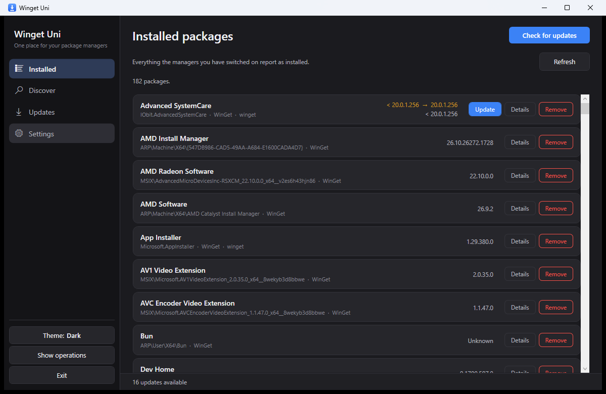
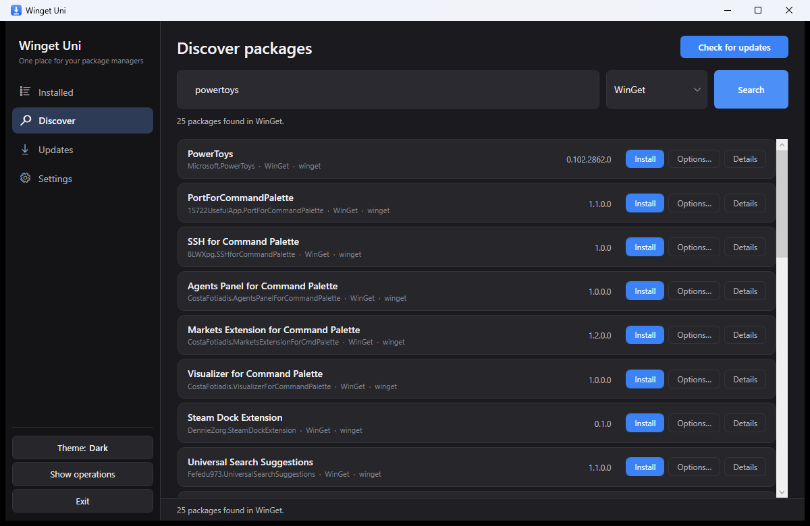
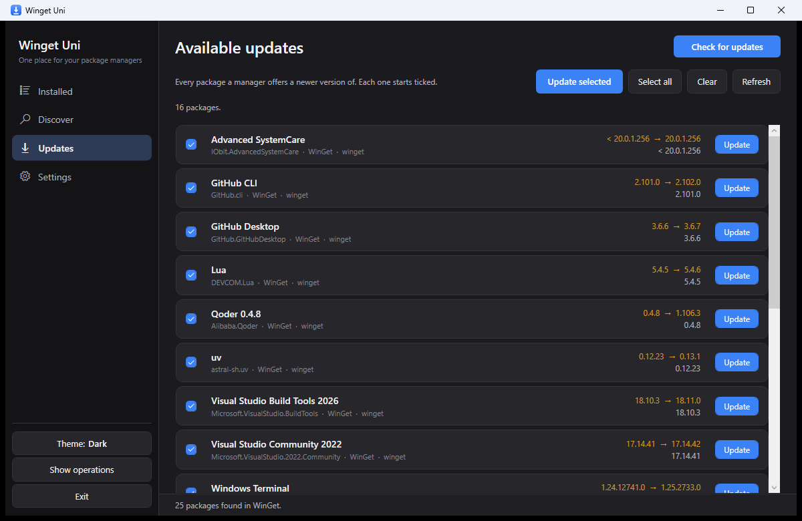
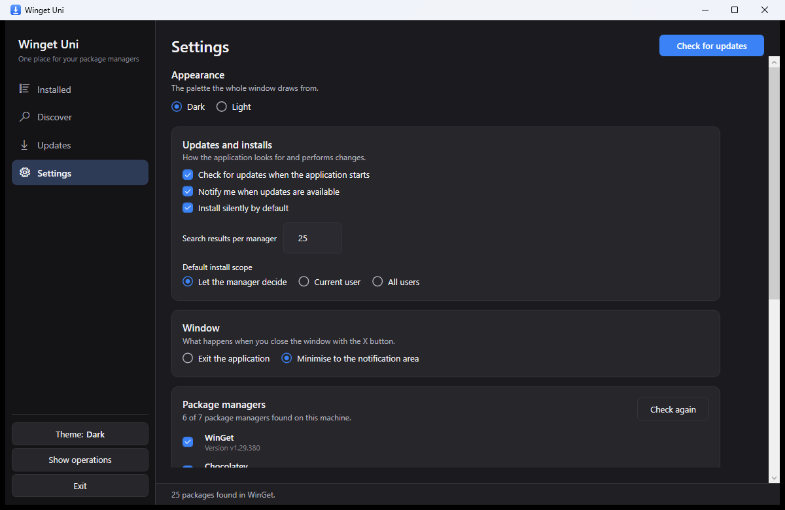

# Winget Uni

**One place for your package managers.**

Winget Uni is a Windows desktop application that brings WinGet, Chocolatey, Scoop, pip, npm,
the .NET tool chain, and the PowerShell Gallery together in a single window. Browse what is
installed, search every manager at once, install, update, and remove packages with a click, and
watch long-running operations in a queue that survives closing the window.



## Features

- **One list of everything installed.** Every manager you have switched on is queried and its
  packages appear side by side, each labelled with the manager that owns it.
- **Search across managers.** Search a single manager or all of them from one box, page through
  the results, and install without leaving the list.
- **Updates in one place.** Packages a manager reports a newer version of are collected on the
  Updates page, ticked by default, and can be applied in bulk.
- **A real operation queue.** Installs, updates, and removals are queued and run one at a time,
  with live output. The queue keeps running when the window is closed to the notification area,
  so a long install is not interrupted.
- **Package details.** Any row can be expanded into the full metadata the manager reports.
- **Export and import.** Save the installed set to JSON, or install everything recorded in a file
  written on another machine.
- **Light and dark themes**, a taskbar and notification-area icon, and a close button whose
  behaviour you choose.
- **A manager you do not have is not hidden.** It is still listed, with the reason it is
  unavailable, so Settings explains an absence instead of quietly omitting it.

## Screenshots

### Discover

Search one package manager or all of them, then install straight from the results.



### Updates

Every package a manager offers a newer version of, ready to update together.



### Settings

Themes, update checks, install defaults, the close behaviour, and per-manager switches.



## Supported package managers

| Manager               | Command           | Notes                                   |
| --------------------- | ----------------- | --------------------------------------- |
| WinGet                | `winget`          | Ships with Windows 10/11                |
| Chocolatey            | `choco`           | Machine-wide packages may need consent  |
| Scoop                 | `scoop`           | Per-user packages                       |
| pip                   | `pip`             | Python packages                         |
| npm                   | `npm.cmd`         | Node packages                           |
| .NET Tool             | `dotnet`          | Global .NET tools                       |
| PowerShell Gallery    | `powershell`      | PowerShell modules                      |

A manager that is not installed, or is switched off in Settings, is never queried.

## Requirements

- Windows 10 (1809 or later) or Windows 11.
- The [.NET 9 SDK](https://dotnet.microsoft.com/download) to build and run from source
  (the repository pins the SDK through `global.json`).
- At least one of the package managers above, on `PATH`.

## Getting started

```powershell
# Build everything
dotnet build WingetUni.sln -c Release

# Run the application
dotnet run --project src/WingetUni.App

# Run the tests
dotnet test
```

The first launch probes for the managers it knows, then loads what they report as installed. Any
operation that needs administrator rights is passed to the manager, which raises its own consent
prompt.

## Using the app

- **Installed** is the view it opens on. **Refresh** re-queries every active manager.
- **Discover** searches the manager chosen in the dropdown, which defaults to WinGet and remembers
  your choice. A row installs with the manager's own defaults; the **Options…** action opens the
  dialog for a specific version, scope, or location.
- **Updates** collects available updates. Tick the ones you want and use **Update selected**, or
  update a single row.
- **Operations** (from the rail or **Show operations**) shows the queue and its live output, and
  offers **Cancel current**.
- **Closing the window** hides the app in the notification area by default, so work continues.
  Choose **Exit the application** in Settings if you would rather the X button end it. Either way,
  **Exit** on the rail or in the tray menu ends the application.
- **Settings** holds the theme, startup and notification options, the default install scope, the
  close behaviour, the per-manager switches, the package list tools, and the path of the settings
  file (`%LOCALAPPDATA%\WingetUni\settings.json`).

## How it is put together

| Project                | What it contains                                                                 |
| ---------------------- | -------------------------------------------------------------------------------- |
| `WingetUni.App`        | The WPF application: window, views, view models, theming, tray icon.             |
| `WingetUni.Core`       | Manager-agnostic model: abstractions, parsing, process running, settings, queue. |
| `WingetUni.Providers`  | One provider per package manager, translating its CLI output into that model.    |
| `WingetUni.Tests`      | xUnit tests, exercised against recorded output from the real tools.              |

The design keeps each manager behind a single interface (`IPackageManagerProvider`), so the
interface, the query service, and the operation queue never depend on a particular CLI. Parsing is
driven by the header rows the tools actually emit rather than fixed column offsets, and the tests
run against recorded output instead of hand-written approximations.

## Testing

```powershell
dotnet test
```

The suite covers the parsers, version comparison, the settings round trip, and the operation
queue, with recorded CLI output as fixtures under `tests/WingetUni.Tests/Fixtures`.

## License

Released under the [MIT License](LICENSE).

Winget Uni is an independent project and is not affiliated with Microsoft or any of the package
managers it drives.
